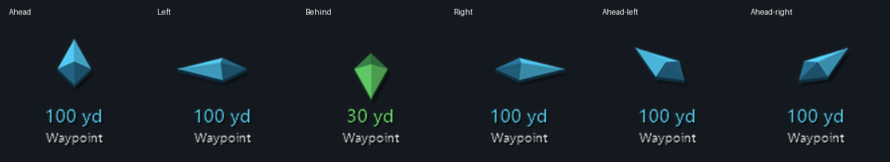

# Wayfinder waypoint arrow, version 1.4.9

The waypoint indicator is a standalone raised, beveled arrow with a longer cyan
point and shorter, darker counterweight. Its diamond-shaped body is 60% wider
than the previous needle, with the same length, perspective, ridge and lighting.
The arrow and distance turn green inside 40 yards.

The compass housing and opaque readout plate have been removed. Small distance
and waypoint-name text have a dark shadow for legibility over the world. The
widget occupies 110x94 UI units instead of 130x128, reducing the drag/click area
by about 38%. Saved position and scale still apply.



This is a generated artwork preview, not an in-game screenshot.

## Generation and heading convention

`tools/make_arrow.py` defines the needle vertices, bevel walls, ridge, camera,
light, and shadow. It draws all geometry procedurally, without loading source
artwork. A fixed orthographic camera at 42 degrees projects the model, and a
fixed light shades its faces while the needle yaws counterclockwise from forward.

128 frames of 128x128 pixels are packed into a 16-column, 8-row, 2048x1024 atlas.
The atlas is an uncompressed 32-bit TGA file, matching the format already used
by Wayfinder. Transparent gutters prevent neighboring frames from bleeding when
textures are filtered. Atlas texture memory is approximately 8 MiB; the game does
not need to render a mesh each update. No compass-base texture is used.

Runtime bearing is `atan2(waypointWest - playerWest, waypointNorth - playerNorth)`
minus player facing. Frame 0 is ahead, 32 left, 64 behind, and 96 right. The nearest
frame limits rounding to approximately 1.4 degrees. Only the UV rectangle changes;
the texture and camera stay fixed, keeping lighting and perspective coherent.

Regenerate assets and illustrative previews with:

```
python tools/make_arrow.py --preview docs
```

`tools/make_icons.py` also regenerates these assets alongside the other map icons.
The compact readout and pointer retain saved position, scale, dragging, tooltip,
right-click removal, waypoint sharing, arrival clearing, and unavailable-position
or other-continent messages.

Clients already running during installation may retain cached texture pixels.
Reloading removes the housing immediately; restart the game if the wider arrow
artwork has not refreshed. If the atlas cannot load, Wayfinder temporarily uses
its existing simple player-pointer artwork with the same bearing calculation
and prints a restart instruction.

## Audit and provenance

The locally installed BuddiesQuestForever 0.9.63 was compared with Wayfinder 1.3.4.
Their four corresponding floating-arrow textures had different file and decoded
pixel hashes. Wayfinder's assets were reproducible from its own icon generator.
The implementations also differed: Wayfinder calculated bearings in continent
world coordinates; Buddies used normalized map positions and map dimensions.

Those differences establish that the files and implementations were not identical;
they do not by themselves prove independent design history. The gold circular
arrow and distance plate were visually similar, so version 1.3.5 replaced that
presentation with newly defined geometry, new artwork, and a different layout.
Version 1.4.9 widens that same arrow and removes the compass housing.

No permissively licensed upstream origin for Buddies' arrow was identified in
the inspected package. Its optional TomTom integration forwards waypoints and
does not establish the arrow's provenance. Buddies' installed license reserves
rights and prohibits copying/modification/redistribution without written permission.
This redesign does not rely on permission from Buddies or TomTom and contains no
artwork copied from either project.

Automated checks cover cardinal and diagonal bearings, wraparound, frame UVs,
asset dimensions and format, transparent gutters, controls, and waypoint behavior.
Visual inspection covers rendered directional frames and the native-size preview.
In-game appearance and controls still need verification in an active client before
claiming client verification. The broader data migration and GPL license remain
as documented separately.
